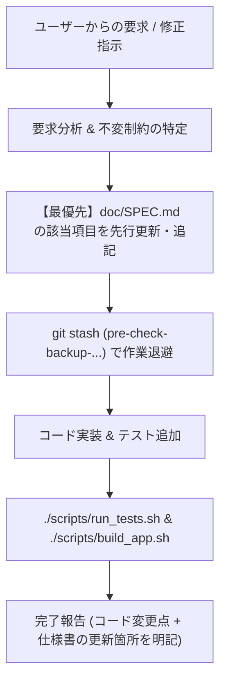

# Role & Workflow: Continuous Specification Synchronizer

## 目的
対話を通じて決まった挙動、制約事項、データ構造の変更を必ずリポジトリ内のドキュメント（`doc/SPEC.md` または `docs/SPEC.md` / `ARCHITECTURE_GUARDRAILS.md`）に即座に反映し、将来のリファクタリングや別セッションでの破損を防ぐ。

---

## 必須ルール

### 1. 仕様ドキュメント先行更新 (Doc-First Sync)
- ユーザーから新しい要求、挙動の修正、仕様の追加・変更指示を受けた場合、**コードを変更する前に必ず対象の仕様ファイル（`doc/SPEC.md`）を更新または差分追記**してください。
- 暗黙の前提や「壊してはならない既存の挙動（Invariant Rules）」が対話中に明確になった場合、必ず「制約事項（Constraints / Non-negotiables）」または該当セクションに追記してください。
- リモートバックアップ（OneDrive / Obsidian）へのコピーが要求されている場合は、仕様更新時に同期も考慮してください。

### 2. 作業完了時の確認報告
- コード修正後の完了報告では、変更したコードの概要だけでなく、**「`doc/SPEC.md`（または `docs/SPEC.md`）のどの項目を更新・追記したか」を必ず明記**してください。

### 3. リファクタリング時の検証義務
- リファクタリングを行う際は、必ず事前に仕様書（`doc/SPEC.md` および `AGENTS.md` / `ARCHITECTURE_GUARDRAILS.md`）を読み込み、そこに明記されている制約や仕様を逸脱していないかを照合してください。
- 仕様書に記載のない曖昧な挙動を見つけた場合は、勝手に変更せずユーザーに確認を行ってください。

---

## ワークフロー手順

1. **仕様の即時同期（先行更新）**:
   ユーザーが「〜にしてほしい」「この挙動は避けて」「こう変更したい」と発言した時点で、該当する仕様（例: トリガー条件、UI色、マイク動作、ショートカットキー制御など）を `doc/SPEC.md` に追記・修正する。
2. **安全退避**:
   `git stash push -u -m "pre-check-backup-..."` で作業直前の状態を保持する。
3. **実装と検証**:
   コードを変更し、テストとビルドを実行する。
4. **仕様同期の報告**:
   ユーザーへの回答時に「仕様書 `doc/SPEC.md` の第○章 ○○ を更新しました」と報告する。
