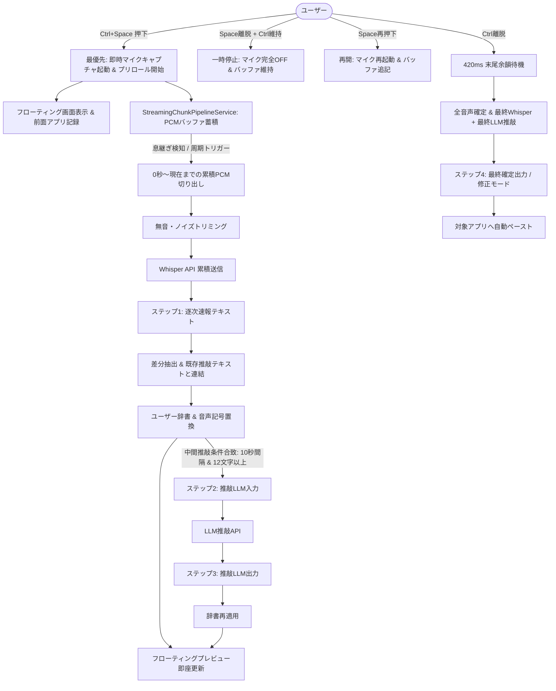

# VoiceIME 技術仕様書 (Architecture & Implementation Specification)

本ドキュメントは、VoiceIME の内部アーキテクチャ、ストリーミングパイプライン処理、キータイミング制御（頭切れ・末尾切れ防止・一時停止）、および**システムの品質・安全性を維持するために絶対に破壊してはならない保護領域**を詳細に定義した公式技術仕様書です。

---

## 目次

1. [システム概要と設計思想](#1-システム概要と設計思想)
2. [パイプライン処理フロー（ログのステップ 1〜4 詳細）](#2-パイプライン処理フローログのステップ-14-詳細)
   - [2.1 累積・紙芝居ストリーミング方式](#21-累積紙芝居ストリーミング方式-cumulative-paper-theater)
   - [2.2 ログの 4 ステップ詳細と変遷](#22-ログの-4-ステップ詳細と変遷)
   - [2.3 Whisper と推敲 LLM へのデータ受け渡し](#23-whisper-と推敲-llm-へのデータ受け渡し)
   - [2.4 差分抽出（extractDelta）と推敲テキストの保全結合（combineRefinedWithDelta）](#24-差分抽出extractdeltaと推敲テキストの保全結合combinerefinedwithdelta)
   - [2.5 旧・一括送信（Batch Transcription）デバッグ機能の完全撤廃](#25-旧一括送信batch-transcriptionデバッグ機能の完全撤廃)
3. [CTRL+SPACE のタイミング制御と音声欠落防止仕様](#3-ctrlspace-のタイミング制御と音声欠落防止仕様)
   - [3.1 開始時の「頭切れ」完全防止機構](#31-開始時の頭切れ完全防止機構-leading-voice-preservation)
   - [3.2 終了時の「語尾・末尾切れ」完全防止機構](#32-終了時の語尾末尾切れ完全防止機構-trailing-voice-preservation)
   - [3.3 思考サポート: プッシュ・トゥ・トーク一時停止 & 再開（Pause & Resume）](#33-思考サポート-プッシュトゥトーク一時停止--再開pause--resume)
4. [見えないところの安全保護設計（破壊防止ガードレール）](#4-見えないところの安全保護設計破壊防止ガードレール)
   - [4.1 CoreAudio / AVAudioEngine クラッシュ防止ルール](#41-coreaudio--avaudioengine-クラッシュ防止ルール)
   - [4.2 Apple Speech vs Whisper 表示の完全分離](#42-apple-speech-vs-whisper-表示の完全分離)
   - [4.3 マイク常時ONの完全防止とオンデマンド・プライバシー保護](#43-マイク常時onの完全防止とオンデマンドプライバシー保護)
   - [4.4 音声認識しきい値（VAD）のユーザー設定 1:1 直結](#44-音声認識しきい値vadのユーザー設定-11-直結)
   - [4.5 ヘッジド・リクエスト（時間差並行レーシング）](#45-ヘッジドリクエスト時間差並行レーシング)
   - [4.6 キーチェーン認証ガイダンス & ヘッドレス MCP モード](#46-キーチェーン認証ガイダンス--ヘッドレス-mcp-モード)
5. [主要コンポーネントとデータフロー](#5-主要コンポーネントとデータフロー)
6. [パイプラインログ形式とデバッグ仕様](#6-パイプラインログ形式とデバッグ仕様)
7. [ログのセキュリティ設計・デフォルトOFF・MCPアクセス制限・システム例外ログ仕様](#7-ログのセキュリティ設計デフォルトoffmcpアクセス制限システム例外ログ仕様)
   - [7.1 パイプラインログのデフォルト OFF とユーザー同意・責任原則](#71-パイプラインログのデフォルト-off-とユーザー同意責任原則)
   - [7.2 MCP（Model Context Protocol）からのアクセス遮断](#72-mcpmodel-context-protocolからのアクセス遮断)
   - [7.3 システム診断・監査・例外ログ](#73-システム診断監査例外ログ-librarylogsvoiceimeyyyymmddlog)
   - [7.4 アプリ起動時の構成状態・LLM推敲ON/OFF・プロバイダ状態記録仕様](#74-アプリ起動時の構成状態llm推敲onoffプロバイダ状態記録仕様)
8. [UI・テーマカラーカスタマイズ仕様（コスメ設定）](#8-uiテーマカラーカスタマイズ仕様コスメ設定)
9. [単語登録（Vocabulary）および辞書データの永続化・保護設計](#9-単語登録vocabularyおよび辞書データの永続化保護設計)
   - [9.1 単語帳と辞書置換ルールの独立保存（Granular Export）](#91-単語帳と辞書置換ルールの独立保存granular-export)
   - [9.2 起動時ディスク優先読み込み保護（Startup Disk Priority）](#92-起動時ディスク優先読み込み保護startup-disk-priority)
   - [9.3 自動バックアップ機能（Auto-Backup）](#93-自動バックアップ機能auto-backup)
   - [9.4 テスト実行環境の完全サンドボックス化（Test Isolation Guardrail）](#94-テスト実行環境の完全サンドボックス化test-isolation-guardrail)
10. [語尾・文末表現の完全保全と画面・ペースト100%一致仕様（Ending Preservation & Visual WYSIWYG）](#10-語尾文末表現の完全保全と画面ペースト100一致仕様ending-preservation--visual-wysiwyg)
    - [10.1 日本語の文末・語尾・否定表現（〜する / 〜しない）の不可侵性](#101-日本語の文末語尾否定表現する--しないの不可侵性)
    - [10.2 連語・複合語中での誤った句点挿入の根絶（Punctuation Safety）](#102-連語複合語中での誤った句点挿入の根絶punctuation-safety)
    - [10.3 画面表示とペースト内容の100%完全一致と十分な目視確認猶予](#103-画面表示とペースト内容の100完全一致と十分な目視確認猶予)

---

## 1. システム概要と設計思想

VoiceIME は、macOS 上で動作する超高速・高精度な Push-to-Talk リアルタイム音声入力・推敲 IME です。

従来の音声入力システムが抱えていた以下の課題を根本から解決するために設計されています：
1. **認識遅延と違和感**: キーを離すまで何が入力されたか分からず不安。
2. **チャンク分割による助詞・文頭の破綻**: 音声を1秒〜2秒でぶつ切りにして送信すると、文脈が途切れて誤認識が多発する。
3. **キー押下・離脱タイミングの欠落**: 話し始めの語頭（「あー」「本日は」）や、キーを離した瞬間の語尾（「〜です」「〜でしょう」）が切れる。
4. **マイク常時稼働によるプライバシー懸念**: 待機中もマイクが起動していると macOS のオレンジのインジケータが点灯し続け、セキュリティ上受け入れられない。



---

## 2. パイプライン処理フロー（ログのステップ 1〜4 詳細）

### 2.1 累積・紙芝居ストリーミング方式 (Cumulative Paper-Theater)

VoiceIME は、音声を固定長で細切れにする「チャンク分割方式」を**採用していません**。
細切れチャンク方式では「〜については」の「に」で切れた場合、後続チャンクが文頭と誤認され助詞が脱落・変換異常を起こすためです。

代わりに採用しているのが**累積・紙芝居ストリーミング方式**です：
- 発話開始（0秒）から現在までの**全 PCM データ**をバッファ（`pcmDataBuffer`）に累積。
- ユーザーの「息継ぎ（無音）」を検知するたびに、0秒〜現在までの音声を丸ごと一時 WAV に書き出し、Whisper に送信。
- Whisper から戻った最新の全文でプレビュー画面を上書き（紙芝居のページをめくるように更新）。

### 2.2 ログの 4 ステップ詳細と変遷

`PipelineLogger.swift` により `~/.voiceime/pipeline.log` にリアルタイムで記録される 4 つのステップは以下の通りです：

| ステップ | ログ名称 | 発生タイミング | 説明・役割 |
| :--- | :--- | :--- | :--- |
| **ステップ 1** | **Whisperから逐次送られてきた文字列** | 途中息継ぎ速報 / 最終確定速報 | Whisper API から返却された生の文字起こし結果（ハルシネーション除去済み）。 |
| **ステップ 2** | **Whisperから推敲LLMへ送られる文字列** | 途中息継ぎ推敲 / 最終確定推敲 | 辞書置換・音声記号変換を適用し、プロンプト指示とともに LLM に渡す入力テキスト。 |
| **ステップ 3** | **推敲LLMから修正され戻される文字列** | 途中息継ぎ推敲 / 最終確定推敲 | LLM が文脈を考慮してフィラー除去・誤字修正・句読点整形を行って返却したテキスト。 |
| **ステップ 4** | **ユーザー手動修正による最終確定出力** | 修正モード / セッション確定 | プレビュー画面での編集（ピン留め・修正）または最終推敲を経てアプリにペーストされる確定文字列。 |

### 2.3 Whisper と推敲 LLM へのデータ受け渡し

#### (A) 途中息継ぎ時の処理フロー
1. **トリガー条件**:
   - `speechFramesSinceLastTrigger` による有声発話時間が 0.50秒以上。
   - 直近の無音時間が `minSilenceDuration`（約 0.45秒）以上、または前回到達から `maxContinuousChunkSeconds`（約 3.0秒）経過。
   - 音量レベルが `speechThresholdDB`（ユーザー設定直結）を超えていること。
2. **Whisper 送信**:
   - `0` 〜 `endSample` までの累積音声から前後無音をトリミング（`trimSilence`）。
   - Whisper API（Groq / OpenAI）に送信。
   - 受信テキストを **「ステップ 1: Whisperから逐次送られてきた文字列 [途中息継ぎ速報]」** として記録。
3. **差分連結と画面速報**:
   - すでに前回の推敲済みテキスト（`latestRefinedText`）がある場合、前回の Whisper 原文との差分（`delta`）を抽出し、推敲済みテキストの後ろに繋げてプレビューを即座に更新。
4. **中間 LLM 推敲の実行判定（レート制限配慮）**:
   - 短すぎる断片（12文字未満）は LLM がハルシネーションを起こしやすいため推敲をスキップ。
   - API のレート制限（Groq/Sarashina 等）を保護するため、中間推敲は最低 **10秒間隔**（`minLLMRefineIntervalSeconds = 10.0`）に制限し、キー解放時の確定推敲枠を温存。
   - 条件合致時、**「ステップ 2: Whisperから推敲LLMへ送られる文字列 [途中息継ぎ推敲]」** を送信し、**「ステップ 3: 推敲LLMから修正され戻される文字列 [途中息継ぎ推敲]」** を受信して画面を全置換。

#### (B) キー解放・最終確定時の処理フロー
1. 音声録音停止後、`StreamingChunkPipelineService.finishAndFinalize()` を呼び出し。
2. 0秒から末尾までの完全な PCM データを一括で Whisper に送信し、**「ステップ 1: 最終確定速報」** を取得。
3. 辞書ルールおよび記号置換を適用したベース文字列を生成し、**「ステップ 2: 最終確定推敲」** として LLM へ送信。
4. LLM の推敲結果を **「ステップ 3: 最終確定推敲」** として受け取り、再度辞書ルールで保護。
5. 最終テキストを `updateConfirmedText()` に渡し、**「ステップ 4: 確定出力テキスト」** として `PipelineLogger.shared.logSessionEnd()` に記録。

### 2.4 差分抽出（extractDelta）と推敲テキストの保全結合（combineRefinedWithDelta）

累積音声を送ると、Whisper は毎回文頭から全文を返します。
しかし、文頭部分はすでに LLM によってきれいに推敲（句読点付与、フィラー削除）されている場合があります。これを単純に Whisper の全文で上書きすると、**「せっかく推敲された前半が、未推敲の粗いテキストに戻ってしまう」** という先祖返りが発生します。

これを防ぐのが以下のアルゴリズムです：

1. **`extractDelta(newText, baseText)`**:
   - 今回届いた Whisper 全文（`newText`）と、前回届いた Whisper 全文（`baseText`）を比較。
   - 接頭辞の一致、または文末アンカー（最長共通部分列）を探索し、新しく話された増分部分（`delta`）のみを抽出。
2. **`combineRefinedWithDelta(refined, delta)`**:
   - すでに推敲済みの前半部分（`refined`）の末尾にある不要な句点（「。」）を賢く処理し、増分（`delta`）を自然に結合。
3. **安全フォールバック**:
   - ユーザーが言い直して文頭から完全にテキストが変化した場合など、差分が安全に特定できない場合は無理に合成せず、最新の Whisper 全文を採用して破綻を防止。

### 2.5 旧・一括送信（Batch Transcription）デバッグ機能の完全撤廃
- **撤廃理由と一本化方針**:
  - 過去にデバッグおよび比較検証用として残されていた「録音終了までAPI送信を保留し、最後にまとめて一度だけ送信する一括送信モード（`batchTranscriptionEnabled`）」は完全撤廃されました。
  - 音声入力パイプラインは、VoiceIME の核心価値である `StreamingChunkPipelineService`（累積・紙芝居ストリーミング方式）に完全一本化されています。
  - これに伴い、UI の一括送信チェックボックス、メニューバーの「一括: ON/OFF」表示、および `AppState` 内の重複していた一括送信タスクコード（`executeBatchTranscriptionTask`）はすべて削除・整理されています。

---

## 3. CTRL+SPACE のタイミング制御と音声欠落防止仕様

Push-to-Talk 方式において最も頻発する問題は、「話し始めの先頭が切れる（頭切れ）」と「話し終わりの語尾が切れる（末尾切れ）」です。VoiceIME では以下の設計によりこれを完全解決しています。

### 3.1 開始時の「頭切れ」完全防止機構 (Leading Voice Preservation)

#### 発生原因
ホットキー（`Ctrl+Space`）が押された際、以下のような重い処理が先行すると、マイクの音声キャプチャ開始が数十〜数百ミリ秒遅れ、最初の1〜2音（「あっ」「本日は」等）が失われます：
- UI ウィンドウの生成・描画
- 前面アクティブアプリケーションの調査（AppleScript / NSWorkspace）
- Keychain からの API キー復号
- 辞書ファイルのディスク読み込み

#### 対処実装
1. **マイク最優先・オンデマンド即時キャプチャ**:
   - `AppState.startRecording()` 内で、UI や Keychain、アプリ検出よりも**最優先の 0 行目**で `StreamingChunkPipelineService.prepareImmediateCapture()` および `LiveSpeechService.startImmediateCapture()` を実行。
2. **プリロール・リングバッファ（Pre-roll Ring Buffer）**:
   - マイクタップが開始された瞬間から、最大 **0.30秒〜0.40秒分（約 9,600 バイト）** の音声フレームを常時保持可能なリングバッファに先行蓄積。
   - 本格的なストリーミング処理 `pipeline.start()` が非同期に呼び出された際、蓄積されていたプリロール音声を PCM バッファの最先頭に自動結合。
3. **視覚的マイク準備完了インジケータ**:
   - マイクの最初のオーディオバッファが CoreAudio から届いた瞬間に `controller.isMicReady = true` を発火。
   - フローティングプレビューのインジケータがオレンジ（起動中）からユーザー指定カラー（青紫・グリーン等）へ切り替わり、確実に声が入る状態を目視可能に。

### 3.2 終了時の「語尾・末尾切れ」完全防止機構 (Trailing Voice Preservation)

#### 発生原因
ユーザーがキー（`Space`）を離した瞬間にマイク録音を即座にシャットダウンすると、人間の発話の「余韻」や語尾（「〜でしょう」「〜ですか」「〜ですよね」）がマイクの内部バッファや CoreAudio ハードウェアから吸い出される前に途切れてしまいます。

#### 対処実装
1. **KeyUp 時の 420ms 余韻ディレイ**:
   - `handleHotKeyUp()` 検知時、`AVAudioEngine` の停止処理を即座に行わず、**`0.42秒（420ms）` の遅延待機**（クイック質問時は 200ms）を設けてから `stopRecordingAndTranscribe()` を実行。
   - キーを離した直後の最後の1音まで確実に PCM バッファへ取り込みます。
2. **体感ラグの完全排除（即時 UI フィードバック）**:
   - 録音自体は 420ms 継続しますが、画面上はキーを離した瞬間に即座に `FloatingPreviewController.setProcessing()` を呼び出してローディング表示に切り替えます。
   - これにより、ユーザーは「待たされている」感覚を一切持たず、裏で音声が綺麗に回収されます。

### 3.3 思考サポート: プッシュ・トゥ・トーク一時停止 & 再開（Pause & Resume）

音声入力中に言葉に詰まったり考えたりする際、キーを離してセッションが確定してしまったり、逆にマイクを開けっ放しにして周囲の音を拾ってしまったりするのを防ぐ機能です。
※ 補助キー（`hotkeyModifiers`：例 Control, Command, Option, Shift 等）およびメインキー（`hotkeyCode`：例 Space 等）はユーザー設定に動的に追従し、コードやメッセージ内で特定のキー名をハードコードしてはなりません。

#### 動作マトリクス
| ユーザー操作 | アプリの内部状態 | マイク状態 | プレビュー画面 | 音声バッファ |
| :--- | :--- | :--- | :--- | :--- |
| **ショートカット押下中** | `recording` | **ON** (インジケータ点灯) | リアルタイム認識結果表示 | PCM バッファに追記 |
| **補助キー押したまま メインキー離脱** | `recording` + `isRecordingPaused = true` | **OFF** (マイク完全停止) | **未送信音声を即時Whisper送信 ➔ 直ちにSarashina推敲を開始し「推敲準備中...」と表示**。推敲完了と同時に整ったテキストを表示して `⏸️ 一時停止中` で待機 | **全データをそのまま保持** |
| **補助キー押したまま メインキー再押下** | `recording` + `isRecordingPaused = false` | **ON** (マイク再起動) | 録音中プレビューに復元し、**推敲済みテキストの後ろに続きの発話を描き足す**（推敲実行中の場合は完了を待機して安全に合流） | **既存バッファの後ろに連続追記** |
| **補助キー離脱** | 確定フェーズへ移行 | **OFF** | すでに推敲完了済みなら **0msで即座にペースト**（推敲中なら完了を待機してペースト） | 全体を結合した 1 本の WAV として確定 |

- **一時停止時の全文字即時同期と推敲準備中ウェイト（Hold-Time Polish）**: メインキー離脱時、直前トリガー以降の未送信音声（語尾・余韻）を直ちに Whisper API へ送信してプレビューを全文字同期した上で、直ちに Sarashina3-mini による推敲を開始する。推敲中はプレビュー画面に「推敲準備中...」と明示してユーザーに少し待ってもらい、整った文章が完成した時点で「一時停止中 (メインキーで再開 / 補助キー離して入力)」と表示して再開・確定の準備完了とする。
- **推敲準備中のメインキー再押下ガード（衝突完全防止）**: 推敲実行中にメインキーが押された場合、通信を乱暴にキャンセルして破綻させるのではなく、推敲完了を待機して整ったテキストを最新状態として確定させた上でマイク録音を再開する。これにより、古い推敲結果が新しい発話を巻き戻す競合エラーを 100% 防止する。
- **再開時の続き描写（ストリーミング継続）**: メインキー再押下時は既存のバッファおよび `latestRefinedText` / `lastWhisperBaseText` を保持したまま録音を再開し、新たな発話差分を末尾に追記して続きを描く。
- **動的キー名メッセージ**: 一時停止中のステータスメッセージやガイド表示は、設定されたショートカットキーの表示名（`settings.hotkeyDisplayString` やキー名）から動的に組み立てる。
- **プライバシー保護**: 一時停止中は `LiveSpeechService.stopLiveRecognition()` により `AVAudioEngine` を完全に停止するため、**macOS のオレンジのマイク点灯が確実に消灯**します。
- **連続結合**: 再開後に話した音声は、一時停止前の音声と同じ `pcmDataBuffer` にそのまま追記されるため、Whisper および LLM には一続きの自然な長文として渡されます。
- **即時確定**: 一時停止中に「この内容で十分」と補助キーを離した場合、すでにマイクは止まっているため 420ms の待機も挟まず、即座に確定処理へと進みます。

---

## 4. 見えないところの安全保護設計（破壊防止ガードレール）

コードリファクタリングや改修時に、絶対に壊してはならない 6 つの重要内部仕様です。

### 4.1 CoreAudio / AVAudioEngine クラッシュ防止ルール
- **`setDeviceID` の呼び出し禁止（録音本体の経路）**:
  - `engine.inputNode.auAudioUnit.setDeviceID(...)` は macOS のオーディオサブシステム内部でエラー `-10868` を引き起こし、アプリを強制クラッシュさせます。**録音本体（`LiveSpeechService` / `AudioRecorderService` / `StreamingChunkPipelineService` に至る Push-to-Talk 経路）では絶対に呼んではいけません**。録音用エンジンは常にシステムのデフォルト入力を自然に開かせます。
  - **例外（明文化）**: 設定画面のマイクレベルテスト（`MicrophoneLevelTester`）が使う専用の一時 `AVAudioEngine` に限り、`AudioDeviceService.setupInputDevice(for:)` 内での `setDeviceID` 呼び出しを許容します（録音本体の経路を通らず、音声認識・送信を行わないため）。この例外を録音本体へ流用・拡大してはなりません。
  - **背景（経緯）**: かつて、キー押下前から先頭単語が落ちる問題への対策として「マイク常時スタンバイ」方式を採っていましたが、セキュリティ（マイク常時ON）の理由で撤廃しました。現在はプリロール・リングバッファ方式（3.1）で頭切れを防ぎます。常時スタンバイを復活させてはいけません（4.3 参照）。
- **`installTap` のフォーマット**:
  - `inputNode.installTap` に渡すオーディオフォーマットには、勝手な仮想フォーマットではなく、必ず `inputNode.outputFormat(forBus: 0)` を渡すこと。

### 4.2 Apple Speech vs Whisper 表示の完全分離
- macOS 標準の Apple Speech（`SFSpeechRecognizer`）は語頭や固有名詞の誤変換が多く、フローティングプレビューの品質を著しく損ねます。
- `LiveSpeechService.shared.startLiveRecognition` のコールバックは `{ _ in }` のダミーとし、**Apple Speech の認識結果をプレビュー画面に反映してはいけません**。
- 画面に表示するテキストは、必ず `StreamingChunkPipelineService`（Whisper API）から届いたテキストのみを採用すること。

### 4.3 マイク常時ONの完全防止とオンデマンド・プライバシー保護
- 録音を行っていない待機中（idle時）や一時停止（paused時）に、バックグラウンドで `AVAudioEngine` をウォームアップ起動したままにしてはいけません。
- マイクは必ず `startRecording()` / `resumeRecording()` 時にオンデマンドで起動し、キー離脱やキャンセル時には `engine.stop()` および `engine = nil` でハードウェア資源を即座に解放すること。

### 4.4 音声認識しきい値（VAD）のユーザー設定 1:1 直結
- `StreamingChunkPipelineService` のトリガー判定および無音トリミング処理において、コード内に `-4.0dB` や `-34.0dB` 等の固定オフセットをハードコードしてはいけません。
- 必ずユーザーが設定画面で調整した `settings.audioThresholdDB` に 1:1 でダイレクトに連動させること。
- 有声発話の判定には、単なる経過時間ではなく、しきい値を超えた **有声フレーム数（`speechFramesSinceLastTrigger`）** を用いること。これにより、無音環境でキーを押しっぱなしにした際の無駄な API 送信ループを防止します。

### 4.5 ヘッジド・リクエスト（時間差並行レーシング）
- メインプロバイダ（例: Groq）にリクエストを送信した後、1.8秒（推敲時は1.5秒）経過してもレスポンスが返らない場合、バックアッププロバイダ（例: OpenAI）へ並行して同一リクエストを発射します。
- どちらか早く成功した方の結果を即座に採用し、遅い方のタスクをキャンセルすることで、クラウド側のスパイク遅延によるフリーズを回避します。

### 4.6 キーチェーン認証ガイダンス & ヘッドレス MCP モード
- アプリの差し替えや初回起動時には、macOS キーチェーンのアクセス許可ダイアログが背面に隠れてフリーズするのを防ぐため、`promptKeychainWarmupIfNeeded()` によるガイダンスモーダルを表示すること。
- ただし、`--mcp`（Model Context Protocol サーバー）引数付きで起動された場合は、CLI ツールとして完全サイレントに動作させるため、GUI ウィンドウやアラートを一切表示しないこと。

---

## 5. 主要コンポーネントとデータフロー

```
[Hardware Microphone]
       │ (16kHz PCM Float32)
       ▼
[LiveSpeechService] ── (Audio Buffer Tap)
       │
       ▼
[StreamingChunkPipelineService] 
       ├─ [Pre-roll Ring Buffer] (0.30s 頭切れ防止)
       ├─ [pcmDataBuffer] (累積PCM音声蓄積)
       ├─ [AudioAnalysisService] (RMS/Peak VAD判定)
       │
       ├── (息継ぎ検知: 累積音声) ──► [WhisperAPIService] ──► [extractDelta] 
       │                                                         │
       │                                                         ▼
       │                                              [FloatingPreviewController]
       │                                                         │ (リアルタイムプレビュー)
       │                                                         ▼
       ├── (確定時 / 10s間隔) ──► [LLMService] ───────► [FloatingPreviewView]
       │                             (推敲整形)                  │
       ▼                                                         ▼
[TextPasterService] ◄───────────────────────────────────── (ペースト実行)
       │ (CGEvent ⌘V)
       ▼
[Frontmost Target Application (エディタ, ブラウザ等)]
```

---

## 6. パイプラインログ形式とデバッグ仕様

音声入力の全変遷は、ユーザーが明示的にログ記録を有効化した場合に限り、`~/.voiceime/pipeline.log` に以下のようなフォーマットで記録されます。不具合調査や変換精度の検証時には、このログファイルを確認することで、Whisper からの生データ、推敲 LLM への入力、推敲 LLM からの出力、および最終確定の各段階を完全に追跡できます。

```text
==================================================
[2026-10-25 00:23:33.428] 🎙️ 音声入力セッション開始
==================================================

1. Whisperから逐次送られてきた文字列 [途中息継ぎ速報 - 2026-10-25 00:23:34.120]:
本日の進捗について報告します

2. Whisperから推敲LLMへ送られる文字列 [途中息継ぎ推敲 - 2026-10-25 00:23:34.125]:
本日の進捗について報告します

3. 推敲LLMから修正され戻される文字列 [途中息継ぎ推敲 - 2026-10-25 00:23:34.850]:
本日の進捗についてご報告いたします。

1. Whisperから逐次送られてきた文字列 [最終確定速報 - 2026-10-25 00:23:36.210]:
本日の進捗について報告します明日の予定は特にありません

2. Whisperから推敲LLMへ送られる文字列 [最終確定推敲 - 2026-10-25 00:23:36.215]:
本日の進捗について報告します。明日の予定は特にありません。

3. 推敲LLMから修正され戻される文字列 [最終確定推敲 - 2026-10-25 00:23:37.100]:
本日の進捗についてご報告いたします。明日の予定は特にございません。

==================================================
[2026-10-25 00:23:37.105] ✅ 音声入力セッション完了 (確定出力テキスト)
本日の進捗についてご報告いたします。明日の予定は特にございません。
==================================================
```

---

## 7. ログのセキュリティ設計・デフォルトOFF・MCPアクセス制限・システム例外ログ仕様

### 7.1 パイプラインログのデフォルト OFF とユーザー同意・責任原則
- **デフォルト無効化（Privacy by Default）**:
  - `voiceime_pipelineLoggingEnabled` の初期値は **`false`（OFF）** です。
  - ユーザーが明示的に設定画面で ON に切り替えない限り、音声認識テキストや推敲データは一切ディスク（`~/.voiceime/pipeline.log`）に保存されません。
- **ユーザー責任の原則**:
  - ログを ON に設定した場合は「ユーザー自らの意思による明示的な有効化」と位置付けられ、データ保持の責任はユーザーに帰属します。
  - ON に切り替えられた際は、その事実を後述のシステム監査ログ（`~/Library/Logs/voiceime/YYYYMMDD.log`）に記録します。
- **MCPからの設定変更とGUIリアルタイム連動（双方向同期）**:
  - MCPツール（`set_pipeline_logging` 等）からパイプラインログ設定が変更された際、`defaults write` 実行後に `~/.voiceime/.reload` イベントを発火させ、起動中の VoiceIME アプリ内 `@Published var pipelineLoggingEnabled` をメインスレッドで即座に再同期します。
  - これにより、MCP 経由でログが有効化された場合にも、設定画面（`ShortcutSettingsTab`）のチェックボックスおよびメニューバーの状態表示がリアルタイムに ON / チェック状態へと同期されます。

### 7.2 MCP（Model Context Protocol）の初期無効（デフォルトOFF）とアクセス完全遮断
- **デフォルト無効化（Privacy & Security by Default）**:
  - `voiceime_mcpAgentEditingEnabled`（および `voiceime_correctionStockEnabled`）の初期値は **`false`（OFF）** です。
  - ユーザーが明示的に「単語登録・辞書」設定画面で「MCP連携」を ON に切り替えない限り、外部 AI Agent からのアクセスは一切遮断されます。
- **OFF 時のツールアクセス完全遮断**:
  - MCP連携が無効（OFF）の場合、MCP サーバー（`voiceime_mcp_server.py`）に対するすべてのツール実行（辞書一覧・単語追加・修正ストック・ログ取得等）は即時拒否（Access Denied / Error）されます。
  - 外部の LLM やエージェントが MCP 経由で無断で設定・データ・音声ログを参照・変更することを技術的に防止します。
- **起動時およびメニューバーでの可視化**:
  - 起動時システムログ（`~/Library/Logs/voiceime/YYYYMMDD.log`）に `MCP連携: 無効 (OFF - デフォルト)` または `有効 (ON)` を出力します。
  - メニューバー（MenuBarView）の構成サマリー行にも `MCP: OFF`（または `MCP: ON`）を明示表示します。
- **監査ログの記録**:
  - 設定画面から MCP 連携が切り替えられた際、システムログに監査ログ（例: `[AUDIT] MCP連携設定が変更されました: 有効 (ON) / 無効 (OFF)`）を記録します。

### 7.3 システム診断・監査・例外ログ (`~/Library/Logs/voiceime/YYYYMMDD.log`)
音声入力テキストを記録するデバッグ用のパイプラインログ（`~/.voiceime/pipeline.log`）とは明確に分離し、macOS 標準のログディレクトリ配下にシステムログを出力します：

- **ファイル配置**: `~/Library/Logs/voiceime/YYYYMMDD.log`（例: `~/Library/Logs/voiceime/20261025.log`）
- **日付別自動ローテーション**: 日付（現地時間 YYYYMMDD）ごとに自動でファイルが分割されます。
- **記録対象イベント**:
  1. **セキュリティ監査イベント (AUDIT)**:
     - ログ記録が ON にされたイベント（例: `[AUDIT] ユーザー操作によりパイプラインログ記録が有効化されました (責任同意)`）
     - ログ記録が OFF にされたイベント
     - MCP からログが無効中にアクセス要求がありブロックしたイベント
  2. **システムエラー & 例外 (ERROR / EXCEPTION)**:
     - Whisper API 通信エラー、HTTP ステータスエラー
     - LLM 推敲 API エラー、タイムアウト
     - CoreAudio / AVAudioEngine 初期化エラー
     - Keychain 読み書き失敗
     - その他キャッチされた内部例外

### 7.4 アプリ起動時の構成状態・LLM推敲ON/OFF・プロバイダ状態記録仕様
- **起動時システムログ記録**:
  - VoiceIME 起動完了時（`AppState.init()`）、現在有効化されているプロバイダ構成と各種機能の ON/OFF 状態を `~/Library/Logs/voiceime/YYYYMMDD.log` に必ず出力します。
  - 記録内容：
    - 音声認識（STT）プロバイダおよび使用モデル（例: `Groq: whisper-large-v3-turbo` または `OpenAI: whisper-1`）
    - AI推敲の ON/OFF 状態（`isLLMRefinementActive`）および推敲に使用される LLM プロバイダ・モデル（例: `Groq: llama-3.3-70b-versatile`）
    - AIクイック質問のプロバイダ・モデル
    - バックアップSTTプロバイダの設定状況
    - パイプラインログ記録状態（デフォルト: OFF）
- **設定変更時のリアルタイム監査ログ**:
  - ユーザーが設定画面で「AI推敲のON/OFF」を切り替えた際、および「使用LLMプロバイダ/モデル」を変更した際にも、システム監査ログ（AUDIT）として変更後の状態を即時記録します。
- **メニューバーでの状態可視化**:
  - メニューバーアイコンをクリックした際にも、現在のSTT/LLMプロバイダおよび推敲のON/OFF状態が一目で把握できるようステータスを表示します。

---

## 8. UI・テーマカラーカスタマイズ仕様（コスメ設定）

ユーザーの作業環境や視認性の好みに応じて、フローティングプレビューのアクセントカラー（インジケータ・ボーダー・状態表示）をカスタマイズできる仕様です。

- **テーマプリセット**:
  - **Indigo（青紫 - デフォルト）**: `#5856D6` / `Color.indigo`（青寄りの紫、macOS標準アクセントと調和）
  - **Purple（紫）**: `#AF52DE` / `Color.purple`
  - **Blue（青）**: `#007AFF` / `Color.blue`
  - **Teal / Cyan（青緑）**: `#30B0C7` / `Color.teal`
  - **Green（緑）**: `#34C759` / `Color.green`
  - **Orange（オレンジ）**: `#FF9500` / `Color.orange`
  - **Pink（ピンク）**: `#FF2D55` / `Color.pink`
  - **カスタムカラー**: カラーピッカーによる自由設定（HEXカラーコード保存）
- **状態別カラー動態**:
  - **マイク起動準備中（ウォームアップ）**: 視覚的注意を促すオレンジ点灯
  - **音声認識中（録音中）**: ユーザー設定テーマカラー（青紫等）のパルス点灯
  - **一時停止中（Pause & 思考中）**: イエロー/アンバーの点滅による保留明示
  - **推敲・API通信処理中**: プログレスサークルによるローディングアニメーション

### 8.1 メニューバーポップオーバー（MenuBarView）のカード型モダナイズ仕様
- **適正幅の確保**:
  - 従来の極小幅（190px）から macOS 標準の **248px** へ拡幅。
  - テキストの不自然な折り返し（「推」と「敲:」の縦割れ、ステータスメッセージの窮屈な分割）やモデル名（`sarashina3-mini`）の末尾省略（`..`）を根絶。
- **クイック設定のカード化（Control Card）**:
  - `マイク`、`言語`（自動/日本語/英語/翻訳）、`推敲` を角丸カード内にすっきりグルーピング。
  - 推敲設定を「チェックボックス＋分割ボタン」から 1 つの「OFF / 口語 / 文章」ピル型 3-way セレクターに統一し、操作性と見た目のシンプルさを両立。
- **冗長なデバッグ情報のノイズ除去**:
  - メニュー中央を占有していた `構成: STT: Groq | LLM: Sa... | MCP: ON` の文字列行を撤去し、ヘッダーに静かなプロバイダバッジ（`[Groq]` 等）として統合。
- **直前入力カードの洗練**:
  - `直前の入力` セクションをインセットカード＋認識プロバイダカプセルバッジ＋コピーボタンにリファインし、ワンタップコピーを直感的に提供。

---

## 9. 単語登録（Vocabulary）および辞書データの永続化・保護設計

アプリのアップデート、再インストール、またはユニットテスト実行時において、ユーザーが蓄積した登録単語（`vocabulary.json`）および辞書置換ルール（`dictionary.json`）が意図せず消去される事故を 100% 防止するための保護設計です。

### 9.1 単語帳と辞書置換ルールの独立保存（Granular Export）
- **保存処理の完全分離**:
  - `exportDictionaryRulesToDisk(rules:)` と `exportVocabularyToDisk(vocabulary:)` を別々の独立した関数として実装する。
  - 辞書置換ルール（`dictionaryRules`）が更新・初期化された際、`vocabulary.json` を巻き添えで上書き・書き出ししてはならない。
  - 単語登録（`customVocabulary`）が更新された際も同様に、`dictionary.json` を上書きしてはならない。

### 9.2 起動時ディスク優先読み込み保護（Startup Disk Priority）
- **事前上書きの完全禁止**:
  - `AppSettings.init()` 実行時、ディスクからの同期（`syncOnLaunch`）が完了する前に、メモリ上の空データ（`[]`）でディスク上のファイルを上書きする `export` 処理を発火させてはならない。
- **ディスク存在時の優先インポート**:
  - アプリ起動時、ディスク（`~/.voiceime/vocabulary.json`）に単語リストが存在する場合、たとえアプリの `UserDefaults` 側が未設定や空であっても、ディスク側のデータを最優先で正として読み込み、`UserDefaults` 側へ書き戻して復元・保護する。
  - `vocabulary.json` と `dictionary.json` の作成・同期判定は個別に実施し、片方が存在しない場合でも既存の他方を巻き添えで初期化してはならない。

### 9.3 自動バックアップ機能（Auto-Backup）
- **`.bak` ファイルの退避**:
  - `vocabulary.json` または `dictionary.json` を更新・書き出しする直前に、既存ファイルが存在しかつ空でない場合、自動的に `.bak`（例: `vocabulary.json.bak`）として複製退避する。
  - これにより、外部要因によるファイルの不整合や破損が生じた場合にも、直前のデータを即座にサルベージ可能とする。

### 9.4 テスト実行環境の完全サンドボックス化（Test Isolation Guardrail）
- **本番ディレクトリへの干渉の絶対禁止**:
  - `TestRunner.swift` で実行されるすべてのユニットテスト（`testDictionaryService`, `testCorrectionStockService`, `testVoiceIMEDiskSync` 等）は、必ず実行開始時に `VoiceIMEDiskSyncService.shared.customBaseDirectory` を `/tmp/voiceime_test_...` 等の孤立した一時ディレクトリに差し替えて実行する。
  - テスト終了時には一時ディレクトリを安全に破棄し、`customBaseDirectory` をクリアする。
  - 開発者や CI がテスト（`./scripts/run_tests.sh`）を実行したことによって、ユーザーの本番 `~/.voiceime` 配下のファイル（`vocabulary.json`, `dictionary.json`, `corrections.json`）が変更・消去される事態を根本から排除する。

---

## 10. 語尾・文末表現の完全保全と画面・ペースト100%一致仕様（Ending Preservation & Visual WYSIWYG）

日本語の文章においては、最後の語尾（例：「〜する」と「〜しない」、「〜である」と「〜ではない」など）が文全体の肯定・否定や意味を決定づけます。そのため、話した内容の語尾が途中で切れたり、ルールベース整形やAI推敲によって誤って分断・改変されたり、フローティングウィンドウの表示内容と実際にペーストされる文字列に食い違いが生じることを 100% 防止します。

### 10.1 語中「です/ます」誤分断防止とLLM入力の保全
- **語中での句点（`。`）誤挿入の完全禁止**:
  - `PunctuationService.format` のルールベース句点挿入において、「のですべて」「ですし」「ですと」「ですから」など、`です` / `ます` の直後にひらがなや単語の続きが連接している場合に、語中で `のです。べて` のように誤って句点を挿入することを厳禁とする。
  - `です` / `ます` への句点挿入は、直後が空白や文末、または次の文の開始であることが確実な場合のみに限定し、直後にひらがな（`[ぁ-ん]`）や句読点・閉じ括弧が続く場合は絶対に句点を挿入しない。
- **LLM推敲有効時のルールベース前処理の抑制**:
  - LLM推敲（`isLLMEnabled == true`）が有効な場合、Whisperの認識テキストに対して正規表現による機械的な句読点挿入（`PunctuationService.format` のルールベース句点分割）を事前適用せず、ユーザー辞書置換および音声コマンド置換のみを適用した自然な原文をそのままLLMへ渡す。これにより、機械的な句点挿入が単語を分断してLLMの推敲結果（重複表現や語尾崩れ）を誘発する事態を防止する。

### 10.2 LLM推敲における語尾・肯定否定の厳格維持ルール
- **システムプロンプトでの不変制約**:
  - LLM推敲用のシステムプロンプト（`defaultCasualPrompt`, `defaultFormalPrompt`, および `~/.voiceime/prompts.json`）において、**「文末の肯定・否定（『〜する』と『〜しない』等）や語尾のニュアンスは文の意味を決定づけるため、絶対に反転・省略・改変しないこと」** および **「『表示するすることが』のような動詞の重複（スタッター）を発生させず自然な日本語に整えること」** を最優先ルールとして明記する。
- **最終チャンク（語尾）の確実な回収**:
  - キー（`Ctrl+Space`）を離した時点の `finishAndFinalize()` において、録音終了間際に話された語尾まで含めた最終 Whisper 認識結果を確実に取得し、中間チャンクとの間で漢字表記ゆれ（例：`何々` と `何何`、`全て` と `すべて`）があっても語尾が欠落しないよう統合する。
  - 最終 Whisper 認識結果が返った瞬間（LLM最終推敲の完了を待つ前）に、直ちにフローティングウィンドウへ全文（語尾を含む）を反映し、ユーザーが話した末尾まで認識されていることを即座に視覚確認できるようにする。

### 10.3 フローティングウィンドウ表示とペースト文字列の100%完全一致（WYSIWYG保証）
- **単一確定文字列（Single Source of Truth）の徹底**:
  - 最終的にターゲットアプリへペースト（またはクリップボードへコピー）される最終文字列 `processedText` と、フローティングウィンドウに確定表示される文字列（`FloatingPreviewController.shared.updateConfirmedText(processedText)`）は、すべての後処理（句読点正規化・辞書適用・LLM推敲）が完了した後の**完全に同一の文字列インスタンス**でなければならない。
- **語尾まで目視確認できるウィンドウ表示時間の確保**:
  - キーを離して確定テキスト（語尾まで含めた最終結果）がフローティングウィンドウに表示された後、ウィンドウが一瞬（0.35秒等）で消えてしまい「推敲前の途中経過しか目に入らず、ペーストされた結果と違って見える」現象を防ぐため、自動ペースト完了後も最低 **2.5秒間**（またはユーザー設定の `floatingPreviewDuration` のうち長い方）は確定テキストをウィンドウ上に表示し続け、ユーザーが文末・語尾まで画面上でしっかり目視確認できるようにする。

### 10.4 ホールド中（Ctrl+Space押下中）の語尾回収トリガー・失敗時リトライ・長文スクロール表示保証
- **ホールド中の失敗時自動リトライ（発話フレーム消失の防止）**:
  - `Ctrl+Space` を押し続けている最中の途中 Whisper 送信（`processCumulativePaperTheater`）において、通信完了前に `speechFramesSinceLastTrigger` を消失させたままにしない。万一ネットワークエラー・タイムアウト・レート制限等で途中 Whisper 送信が失敗または中断した場合には、未反映の発話フレーム数（`speechFramesSinceLastTrigger`）とリトライフラグ（`hasPendingRetry`）を復元し、ユーザーが話し終えて `Ctrl+Space` を押し続けている間（無音待機中）にも自動的に再試行して、最後の語尾まで確実に画面へ反映する。
- **語尾の減衰音（小声の語尾）の検出と語尾キャッチアップトリガー（Tail Catch-up）および1.5秒言い終わり待機フラッシュ**:
  - 日本語の発話では文末の語尾（「〜ました」「〜ない」「〜です」「〜ございます」等）の音量が自然に減衰するため、一度発話が始まった後（`totalSpeechFrameCount > 0`）で小休止以内または言い直しを含む区間では、`trimSilence` の発話保持基準と同様に減衰語尾（`silenceThresholdRMS * 0.45`、約 `-7 dB` 相当、かつノイズフロア以上）も発話フレームとして漏らさずカウントする。また、`trimSilence` の語尾終了判定しきい値（`trailingFloorDB`）も `min(speechThresholdDB - 8.0, -45.0)`、末尾マージン（`trailingMargin`）を `0.45秒` とし、小声の語尾が末尾無音カットで切り落とされることを 100% 防止する。
  - さらに、前回のトリガーが息継ぎなしの語中（`silentDuration < 0.18s`）で発火した場合や、前回トリガー後に小声の語尾フレーム（`quietTailFramesSinceLastTrigger`）が存在した後に小休止（`silentDuration >= 0.25s`）に入った時点で、確実に語尾キャッチアップ送信を発火させる。
  - **5.0秒言い終わり待機フラッシュ（Flush Trigger）**: 通常の会話中の句読点やじっくり考えながら話す間（数秒程度）で誤判定して不要な通信を誘発することを徹底して防ぐため、話し終えてキーを押したまま待機している状態の静寂判定基準を **5.0秒（`silentDuration >= 5.0s`）** とする。未送信の音声（有声フレームまたは小声語尾フレーム）が残ったまま 5.0秒 待機した場合、言い終わりと判定して Whisper API へ累積送信し、キーを離す前に最後の言葉までプレビュー画面へ確実に反映する。
- **長時間録音時のバースト制限回避とタイムアウト延長**:
  - 1分を超える長文発話において、語中で1.2秒ごとに過剰な累積リクエストが連発されて API レート制限やタイムアウトを引き起こすのを防ぐため、無休止連続発話時の強制トリガー閾値を `newSpeechDuration >= 2.2秒` に適正化しつつ、息継ぎ・言い終わり（`silentDuration >= 0.12〜0.20秒`）では即座にトリガーする。また、長尺累積WAVの送信でもタイムアウトしないよう `WhisperAPIService` のタイムアウトを `15.0秒` とする。
- **ホールド中（非編集モード時）の長文末尾自動スクロールとパネル高さ追従**:
  - `+` キーを押して編集モード（`isEditable = true`）に移行する前の `Ctrl+Space` 押下中（`isEditable = false`）であっても、長文の末尾（語尾）まで画面上で隠れずにすべて表示されるよう、`AutoScrollingTextView.updateNSView` でテキスト更新時に `layoutManager.ensureLayout` を強制実行した上で `scrollRangeToVisible` および `scrollToEndOfDocument` により最下部へ確実にスクロールさせる。
  - さらに、テキストエリアの最大表示高さ（`maxHeight`）を拡大するとともに、`FloatingPreviewController.updatePipelineText` 呼び出し時にもパネルサイズ・位置の追従更新（`updatePanelPosition()`）を行い、ホールド中に文字が増えてもウィンドウが適切に広がって末尾まで一目で確認できるようにする。

### 10.5 ホールド中（Ctrl+Space押下中）のリアルタイムLLM推敲完結とリリース時の即時確定（Hold-Time Refinement & Zero-Post-Release Mutation）
- **Whisperタスクと中間LLM推敲タスクの分離（キャンセル競合の完全排除）**:
  - `Ctrl+Space` 押下中の累積Whisper通信タスク（`currentProcessingTask`）と中間LLM推敲タスク（`currentLLMTask`）を分離し、次の息継ぎWhisperトリガーが発火した際に実行中の中間LLM推敲タスクをキャンセル（`NSURLErrorCancelled: -999`）してはならない。
  - 中間LLM推敲が完了した時点で、推敲中に後続のWhisper差分が到着していた場合は、推敲完了テキストにその差分を安全に結合（`combineRefinedWithDelta`）して画面へ反映する。
- **差分空（`delta.isEmpty`）時および前回末尾微修正時の推敲済みテキスト上書き防止**:
  - 後続のWhisper認識結果が前回と同一内容（`delta == ""`）であった場合に、`else { textToRefine = cleanTranscribed }` によって推敲済みテキスト（`latestRefinedText`）を生のWhisperテキストで上書き・先祖返りさせることを厳禁とする。
  - また、後続のWhisper認識で前回チャンクの末尾数文字（例：`動画が成長します` ➔ `動画が正常に再生できます`）が文脈修正された場合でも、末尾から数文字さかのぼったアンカー位置（例：`スペックによっては`）を特定して未推敲の末尾部分のみを差し替え、前半で既にLLM推敲が完了している箇所（例：`上記環境でも`）を生のWhisperテキスト（`蒸気環境でも`）へ先祖返りさせない（`extractDeltaWithTailRevision`）。
- **Sarashina3-mini高品質推敲と通信完了待機・画面表示同期確定仕様（Latency Tolerance & Visual Integrity）**:
  - 高度な日本語文脈理解・句読点補正（「苦闘点」➔「句読点」への適切な漢字修正、自然な読点「、」や句点「。」の付与）を実現するため、推敲モデルに高品質な `sarashina3-mini` を採用する。
  - `sarashina3-mini` の 6 RPM（10秒に1回）制限を保護するため、話している途中の息継ぎでは Sarashina へのリクエストを無駄撃ちせず、Whisperの高速紙芝居＋辞書置換でリアルタイムに画面を更新する。
  - ユーザーが話し終えてキー（`Ctrl+Space`）を押したまま落ち着いて間（約 `5.0秒`）を置いた瞬間に `sarashina3-mini` 推敲を 1回だけ実行し、キーを離す前のフローティングウィンドウ上で最終推敲文まで完璧に整えて表示する（句読点や思考中の短い沈黙で早漏推敲が走るのを防止）。
  - **ネットワーク遅延等で推敲結果が戻ってくる前にキー（`Ctrl+Space`）を離した場合の完全待機仕様**:
    - 通信遅延によりキー解放時にまだ Whisper や LLM の通信が完了していない場合、決して未推敲の途中テキストで妥協してペーストしてはならない。
    - キーが離された後も通信完了（最後の一つが到着する）まで確実に待機し、到着した最終推敲結果をフローティングウィンドウに表示して同期させた上でペーストを実行する。
    - ペースト後も最低 2.5秒間はフローティングウィンドウに確定文字列を残し、ユーザーが「整った最終結果」を画面で目視確認できるようにする。
  - 音が出ない沈黙時（`newSpeechDuration == 0`）や無音放置時には絶対にリクエストを投げ続けない（無音時送信防止・無駄ループ完全排除）。
  - 末尾の微小な音（「〜ございます」等）の取りこぼしを防ぐため、`trimSilence` の語尾終了判定しきい値 `trailingFloorDB` は `min(speechThresholdDB - 8.0, -45.0)`、末尾マージン `trailingMargin` は `0.45秒` を維持し、小声の語尾フレーム（`quietTailFramesSinceLastTrigger`）も確実にキャッチアップ送信する。

### 10.6 LLM推敲における改行（\n）の厳格維持と自動復元ルール
- **システムプロンプトによる改行保護指示**:
  - LLM推敲用プロンプト（`casualSystemPrompt`, `formalSystemPrompt`, `userPromptTemplate`）に「入力テキストに含まれる改行（\n）は段落や文の区切りであり、絶対に1行に連結・削除せず、改行位置を必ずそのまま維持して出力すること」を厳格に指定する。
- **LLM出力からの改行自動復元ガード（フォールバック保護）**:
  - 万が一、Sarashina 等の LLM が改行（\n）を削除して 1 行に繋げて返却した場合でも、`LLMService.sanitizeLLMOutput` において入力側の改行位置を検出し、`PunctuationService.shared.restorePunctuationAndSpacing` を用いて推敲後テキストへ正確に改行を自動復元する。これにより、音声コマンド「改行」「開業」によって挿入された改行が推敲によって消滅することを 100% 防止する。

### 10.7 最終品質チェックで確定した不変制約（Quality Gate Invariants）
- **音声認識・推敲テキストのシステムログ出力禁止（Privacy by Default の徹底）**:
  - `NSLog` / `print` など macOS 統合ログ（`log show` で永続的に閲覧可能）へ、Whisper 認識結果・LLM 推敲結果・確定テキスト・辞書登録語・AI質問本文を**絶対に出力しない**（出力するのは文字数・件数・状態のみ）。本文を残してよいのは、ユーザーが明示的に ON にした `~/.voiceime/pipeline.log`（`PipelineLogger`）のみ。
- **`pipeline.log` のファイル権限**: 音声認識テキストを含むため、ディレクトリ `0700`・ファイル `0600`（所有者のみ）で作成し、肥大化防止のため 5MB 超過時は古いログを破棄してから追記する。
- **リリース時の最終 Whisper 再送信判定は「有声フレーム」のみで行う**:
  - `finishAndFinalize()` のケース1（再送信スキップ・0ms確定）の可否は `speechFramesSinceLastTrigger`、および `0.12秒以上` の小声語尾フレーム（`quietTailFramesSinceLastTrigger`）の有無のみで判定する。単なる経過サンプル数（無音の蓄積）を「未送信の発話あり」と見なしてはならない（無音ホールド後のリリースで冗長な Whisper 再送信が走り、429 や認識ブレを招くため）。
- **小声語尾キャッチアップの暴走防止**: 実発話（有声フレーム）を挟まない小声語尾キャッチアップ送信は連続 1 回まで。環境ノイズで無音時送信ループが発生してはならない。
- **差分抽出の末尾修正（`extractDeltaWithTailRevision`）**: 推敲済みテキスト末尾を差し替える際は、LLM が付与した末尾の句読点（。、）を除去してから Whisper 側の差し替え文字数分を削る。
- **内部状態の隔離**: `latestRefinedText` / `lastWhisperBaseText` は直列キュー外から読み取れないよう `private` とする。
- **レート制限モデル判定**: 高速モデル判定はモデル名（`nano` / `gpt-4o-mini`）のみで行い、意味のない文字列判定（`groq` 等）は持たない。

### 10.8 Whisper反復幻覚（文字・単語列フレーズループ）の多層サニタイズ仕様
- **発生メカニズムと背景**:
  - 従来の一括送信モード（キー解放後に全体音声を1回送信）と異なり、ストリーミング紙芝居（途中息継ぎ速報）では発話途中の音声スライス（英語固有名詞直後の息継ぎや数ミリ秒の無音）が Whisper へリアルタイム送信される。
  - Whisper（特に `whisper-large-v3-turbo` などの自己回帰デコーダ）は、音声の末尾が文途中で途切れた際に次のトークン予測を見失い、直前の単語列や文字トークンを延々と繰り返してループ生成する既知の特性（Phrase Repetition Loop）を持つ。
  - 途中速報で送られてきた反復テキストが一旦画面にホールドされると、後続の正当な発話差分がその末尾に連結されて画面・確定テキストに汚染が残るため、Whisper レスポンス受信境界（`sanitizeWhisperOutput`）で多層的に圧縮・除去する。
- **反復サニタイズルール**:
  1. **同一1文字の異常連続除去**: 4回以上連続する同一文字（`XXXX...`、`ああああ...`）を1文字に圧縮（`(.)\1{3,}`）。
  2. **3回以上のフレーズ反復圧縮**: 3文字以上の任意フレーズが3回以上連続して繰り返された場合（`(.{3,40}?)(?:[\s、。，．!?！？]*\1){2,}`）、自動的に1回分に圧縮。
  3. **2回以上の英数字複合フレーズ反復圧縮**: 2単語以上の英数字フレーズ（固有名詞等: `Xreal Air 2 Pro Xreal Air 2 Pro`）が連続反復した場合（`(?i)(\b[A-Za-z0-9_\-]{2,}(?:\s+[A-Za-z0-9_\-]+)+)(?:\s+\1)+\b`）、自動的に1回分に圧縮。
  4. **2回以上の長文日本語フレーズ反復圧縮**: 6文字以上の日本語フレーズが連続反復した場合（`([^\s、。，．!?！？]{6,30})(?:[\s、。，．!?！？]+\1)+`）、自動的に1回分に圧縮。
  5. **日常会話の保全**: 「はいはい」「そうそう」「だんだん」「いろいろ」等の短い日常会話・相槌表現は誤検出防止のため除外し、自然な重複表現を破壊しない。
  6. **英語入力モードにおける正当な "Thank you" 発話の保全**:
     - 英語入力時（`language == "en"`）において、"Thank you", "Thank you very much", "Thank you for coming..." などの正当な日常会話・感謝表現をハルシネーションと誤認して削除することを厳禁とする（動画字幕特有の純粋なノイズトークン "Thanks for watching", "Subtitles by..." のみを除去）。
     - 日本語/自動モード時のみ、無音起因の単独英語（"Thank you." のみ）や日本語文字に隣接した英語ハルシネーションを除去する。

### 10.9 音声長に応じた動的タイムアウトと時間差ヘッジド・フォールバック仕様（Dynamic Timeout & Hedged Failover）
- **背景と課題**:
  - Groq（Whisper）は通常 0.3〜0.8 秒で高速応答するが、API サーバー側で稀にパケット詰まりや過負荷による無応答（スタック）が発生する。
  - 固定タイムアウト（15.0秒）のままでは、障害時にユーザー画面が 15 秒以上完全停止し「認識されない」「消えた」という誤認を与える。
- **音声の長さに応じた動的タイムアウト（Dynamic Timeout）**:
  - 送信する音声ファイルの秒数（`durationSeconds`）に基づき、各プロバイダの処理特性に応じた動的タイムアウトを適用する：
    - **Groq**: `max(2.0, min(6.0, 1.4 + durationSeconds * 0.08))`（短文 2.0s、20秒発話 3.0s、45秒発話 5.0s）
    - **OpenAI**: `max(5.0, min(12.0, 3.5 + durationSeconds * 0.12))`（短文 5.0s、30秒発話 7.1s）
- **時間差ヘッジド・フォールバック（Hedged Requests & Instant Error Failover）**:
  - バックアッププロバイダ（OpenAI 等）が有効な場合、`WhisperAPIService.transcribeWithFallback` により以下の二重化並行処理を実行する：
    1. **時間差発射（Hedged Delay）**: プライマリ（Groq）を即座に送信開始し、動的猶予時間 `max(1.8, min(3.5, 1.2 + durationSeconds * 0.05))` 秒経過しても応答がない場合、バックアップ（OpenAI）を並行して発射。先に成功した側の結果を採用し他方をキャンセル（平常時の二重課金を防止）。
    2. **即時障害フェイルオーバー**: プライマリが 429（レート制限）、500系、接続切断等の即時エラーを返した場合、スリープ待機せず 0ms で即座にバックアップを発射。
    3. **フォールバック監査記録**: バックアップが採用された際は、`AppState.shared.lastFallbackRecord` を生成・記録し、メニューバーおよび設定タブに障害回避レポートとして表示。ストリーミング紙芝居（`processCumulativePaperTheater`）およびリリース最終確定（`finishAndFinalize`）の双方で堅牢な二重系を完全保証する。

### 10.10 日英言語モード別推敲プロンプトと約物（記号・句読点）制御仕様
- **背景と課題**:
  - 日本語入力時は疑問符「？」や感嘆符「！」、句読点「、」「。」など全角記号が適切であるが、英語入力時（`language == "en"`）において全角「？」や日本語句読点が混入すると視覚的・構文的に著しく不自然となる。
  - 従来のシステムプロンプトは日本語専用（「必ず文末には句点（。）を付けよ」等）であったため、英語発話時にも LLM が日本語句読点や全角「？」を挿入する不都合が生じていた。
  - さらに、ユーザー辞書ルールにアルファベット直後の `?` を全角 `？` に変換する正規表現が存在したため、推敲OFF時やリアルタイム速報プレビューでも英語文末が全角「？」に化けていた。
- **言語別LLM推敲プロンプトの動的切り替え仕様**:
  - `LLMService.generateSystemPrompt` において、認識対象言語（`language == "en"` または 英語テキスト）に応じて英語専用プロンプト（`englishSystemPrompt`）へ動的に切り替える。
  - **英語専用プロンプトの規約**:
    - 約物はすべて半角（`?`, `!`, `.`, `,`）とし、全角記号（`？`, `！`, `。`, `、`）の使用を厳禁とする。
    - 疑問文には文末に半角疑問符 `?` を配置する。
    - 英語標準の句読点スペーシング（約物の直前スペース禁止、単語が続く直後には半角スペース1文字）を徹底する。
    - 入力テキストの改行（`\n`）は段落や文の区切りとして 100% 維持する。
- **決定論的変換ルール・約物正規化による多層防御（推敲OFF時の保護）**:
  - **辞書ルールの是正**: `AppSettings.defaultDictionaryRules` および `symbolDictionaryRules` において、`?` を全角 `？` に変換するルールは日本語文字直後（`(?<=[あ-んア-ン一-龥])`）のみを対象とし、アルファベット（`[a-zA-Z0-9]`）を対象外とする。
  - **英語モードにおける全角記号の自動半角化**: 英語モード時（`isJapanese == false`）は、確定直前およびプレビュー表示において全角記号（`？` ➔ `?`, `！` ➔ `!`, `。` ➔ `.`, `、` ➔ `,`）を決定論的に半角変換し、推敲が `[OFF]` の状態でも確実に半角 `?` を担保する。
  - **パイプライン言語伝播**: `StreamingChunkPipelineService` の `applyDictionaryRules` およびプレビュー処理に `isJapanese`（`language != "en"`）を確実に伝播させ、速報表示中も全角「？」がチラつかないようにする。
